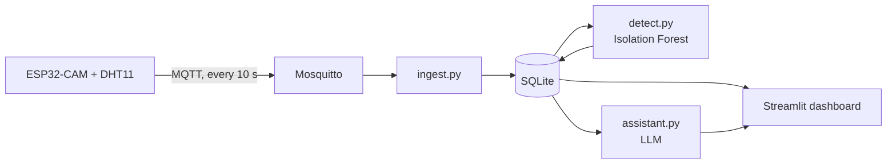

# Smart Room Monitor

A small end to end IoT project. An ESP32 reads temperature and humidity and sends the readings over MQTT into a database. A model flags unusual moments, and a dashboard shows everything. There is also a chat box where I can ask questions about the data in plain language.

I built it to understand how the whole chain fits together, from a sensor on my desk to something a person can look at without touching code. It is a prototype, and the Limits section says where it falls short.


## How it fits together



Everything except the ESP32 runs in Docker Compose: the broker, the ingest script, the detector (it reruns every 10 minutes) and the dashboard.

## Hardware

- AI Thinker ESP32-CAM with its USB base board (I only use the board, not the camera)
- DHT11 temperature and humidity module, signal wire on GPIO 13

## Running it

1. Copy `firmware/include/secrets.example.h` to `secrets.h` and fill in the Wi-Fi name, the password and the IP of the laptop that runs Docker (`hostname -I`).
2. Flash the board from the `firmware` folder with PlatformIO: `pio run -t upload`.
3. From the repo root:

```bash
mkdir -p data notes
cp backend/.env.example backend/.env
docker compose up -d --build
```

4. Open http://localhost:8501.

The chat tab needs an LLM key in `backend/.env`. I used a free Gemini key through its OpenAI compatible endpoint:

```
LLM_PROVIDER=openai
OPENAI_API_KEY=your_key
OPENAI_BASE_URL=https://generativelanguage.googleapis.com/v1beta/openai/
OPENAI_MODEL=gemini-3.8-flash
```

`llm.py` can also talk to Azure OpenAI, OpenAI or Anthropic (set `LLM_PROVIDER` and the matching variables, see `.env.example`). I have only run it with Gemini so far. Without a key everything else still works.

The key lives in `backend/.env` and the Wi-Fi password in `secrets.h`. Git ignores both.

## How the detection works

The readings are averaged to one minute. For temperature and for humidity I compute the value, the difference from its 10 minute rolling mean, the rolling standard deviation and the change since the previous minute. Those go into scikit-learn's Isolation Forest (200 trees, contamination 0.02). Holes in the data are filled if they are shorter than 3 minutes, and the first 10 minutes after a longer gap are skipped, because there is no history to compare against. Hour of day is only used once the data covers at least 20 hours of the day, which mine does not yet.

Flagged moments are saved in an `anomalies` table, and the dashboard draws them as red dots.

## Does it actually work?

Isolation Forest has no answer key, and with contamination at 2% it flags about 2% of the points no matter what. So the flags alone prove nothing.

To check it, I log my own tests with `log_event.py` (breathing on the sensor, mostly) and count a test as caught if a flag lands within 5 minutes after it. A test only counts if the model had scored data in that window, so tests right after a gap or at the very end of the data are reported as "no data" and not as misses. The script also prints a chance level, which is how often a random moment has a flag in the next 5 minutes.

On the data so far, 2 of the 2 testable breathing tests were caught, and the chance level was about 5%. The data is about 3,000 readings, roughly 9 hours, spread over two days with a gap of a day and a half between them. With only two tests I treat the result as encouraging and nothing more.

Two clusters of flags on the first day (around 12:15 and 17:22) do not match any logged test. I did a few informal tests early on without writing down the times, so they might be those, but I cannot show it and I do not count them.

I want to repeat this with a full night of data and more varied tests.

## The assistant

The LLM never writes SQL and never sees the raw database. When I ask a question it first turns it into a time range, like "this morning". Python then builds a summary for that range with pandas: min, max and mean, averages over time, the detected anomalies, my logged test events and any gaps in the data. The LLM answers from that summary only, and it is told to call its explanations hypotheses, since a temperature sensor cannot know the cause. The dashboard has a box showing exactly what the model was given, so I can check an answer against it.

## What I ran into

Flashing failed when the DHT11 signal wire was on GPIO 12. That pin is a strapping pin, and the module pulls it high at boot, which changes the flash voltage. GPIO 13 works fine.

My laptop's IP changed between sessions and the ESP32 kept getting connection errors. Later I found that the broker container was not even running. The compose file now restarts it automatically.

Unplugging the ESP32 leaves gaps in the data. The model skips them, and the plot that `detect.py` saves shades the long ones in grey.

## Limits

- The DHT11 reports whole degrees and responds slowly, so small changes are invisible to it.
- One room, about 9 hours of data and a handful of logged tests. This is not a validated detector.
- MQTT runs without a password or TLS, on my home network only.
- The assistant can still get things wrong, and it only knows what is in the summary.

## Next

- Forward the readings to Azure IoT Hub (the free tier)
- A longer run and more kinds of tests
- A second sensor, ideally something that measures power use

## Layout

```
firmware/    ESP32 code (PlatformIO)
backend/     ingest.py, detect.py, assistant.py, llm.py, dashboard.py, Dockerfile
notes/       events.txt, the tests I log with log_event.py
docker-compose.yml, mosquitto.conf
```